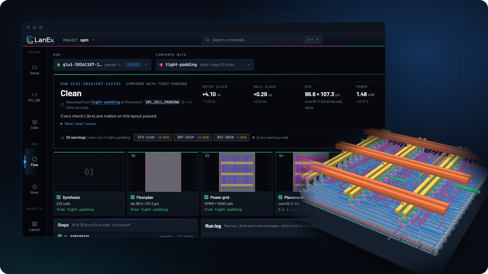
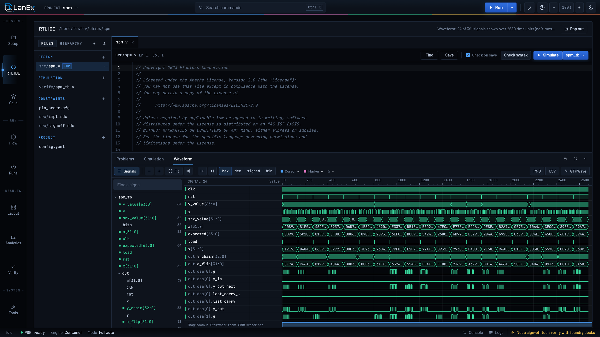
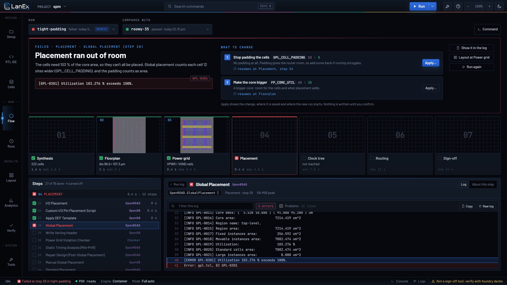
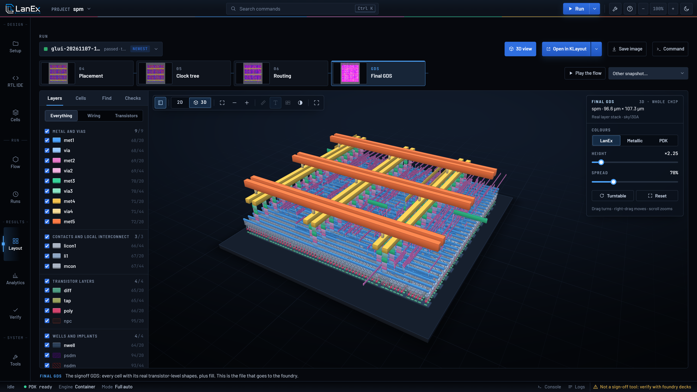
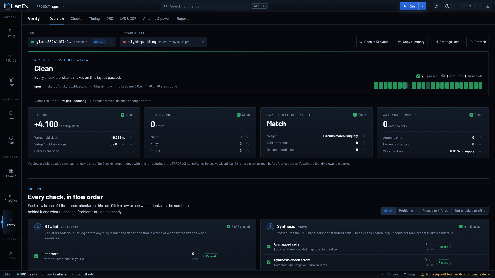
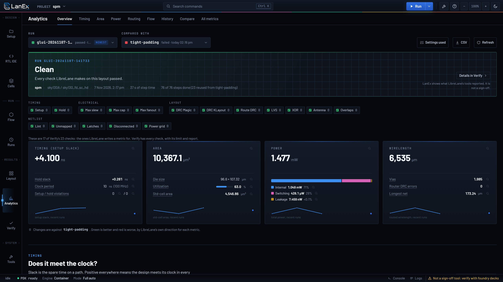
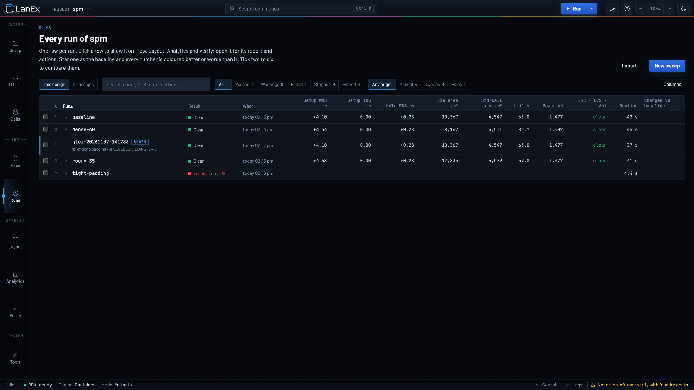

<!-- LanEx — README -->
<div align="center">

<picture>
  <source media="(prefers-color-scheme: dark)" srcset="lanex/server/static/vendor/lanex-logo-dark.png">
  
</picture>

### Take Verilog all the way to silicon — without living in a terminal.

A cockpit &amp; IDE for the [**LibreLane**](https://github.com/librelane/librelane) RTL&nbsp;→&nbsp;GDSII chip flow.

<br>

[](https://github.com/AkshatIsWired/lanex/releases/latest)
[](LICENSE)
[](https://www.python.org/)
[](#for-developers)
[](https://github.com/librelane/librelane)

<a href="#install"><b>Install</b></a> &nbsp;·&nbsp;
<a href="#getting-started"><b>Getting started</b></a> &nbsp;·&nbsp;
<a href="#features"><b>Features</b></a> &nbsp;·&nbsp;
<a href="#documentation"><b>Docs</b></a> &nbsp;·&nbsp;
<a href="#for-developers"><b>For developers</b></a>

<br>



<br>

<table>
<tr>
<td width="33%" align="center" valign="top"><b>No terminal</b><br><sub>Write, simulate, run and inspect your chip from one window.</sub></td>
<td width="33%" align="center" valign="top"><b>Errors you can fix</b><br><sub>A failed run says what went wrong and resumes once you apply the fix.</sub></td>
<td width="33%" align="center" valign="top"><b>The tools' own numbers</b><br><sub>Every value comes from LibreLane's files. LanEx computes none.</sub></td>
</tr>
</table>

</div>

## Install

### Windows

<a href="https://github.com/AkshatIsWired/lanex/releases/latest/download/LanEx-Setup.exe"></a>

1. Run **LanEx-Setup.exe**, accept the license and click **Install**.
2. If Windows asks to restart, let it. Setup carries on after you sign in.
3. Click **Finish**. LanEx opens.

<sub>Windows 11, or Windows 10 22H2 · 64-bit · 8 GB memory · 23 GB free disk · about 15 minutes</sub>

> [!TIP]
> If Windows says "Windows protected your PC", click **More info**, then **Run anyway**. The installer isn't code-signed yet.

### Linux and macOS

```bash
curl -fsSL https://raw.githubusercontent.com/AkshatIsWired/lanex/main/scripts/install.sh | bash
```

Then run `lanex`.

<sub>Ubuntu · Debian · Fedora · Arch · openSUSE · macOS 13+ · WSL2</sub>

<details>
<summary><b>More install options</b></summary>

<br>

Install without questions (for CI and scripts):

```bash
curl -fsSL https://raw.githubusercontent.com/AkshatIsWired/lanex/main/scripts/install.sh | bash -s -- --profile recommended
```

| Profile | Installs |
|---|---|
| `recommended` | Docker, the LibreLane image, Verilator, Icarus Verilog, GTKWave, Graphviz, GDS3D, sky130A |
| `custom` | Your pick of engine, tools, PDKs and libraries |
| `minimal` | The app only |
| `complete` | Every tool and PDK |

Running the installer again upgrades LanEx in place. On Windows, LanEx lives in its own WSL environment and leaves your other distros alone, and uninstalling keeps your projects.

Manual installs, updating, uninstalling and troubleshooting: **[install guide](docs/INSTALL.md)**.

</details>

## Getting started

Open LanEx and pick **Make my first chip**. It takes a small design from Verilog to a finished layout in a few minutes.

With your own design, the flow is four steps:

<table>
<tr>
<td width="25%" valign="top"><b>1 · Write</b><br><sub>Start a project in <b>Setup</b>, then lint and simulate in the <b>RTL IDE</b>.</sub></td>
<td width="25%" valign="top"><b>2 · Run</b><br><sub>Press <b>Run</b> and watch the seven stages on the <b>Flow</b> page.</sub></td>
<td width="25%" valign="top"><b>3 · Fix</b><br><sub>If a run fails, press <b>Apply</b> on the fix sheet. The run resumes.</sub></td>
<td width="25%" valign="top"><b>4 · See</b><br><sub>Look at the chip in <b>Layout</b> and its checks in <b>Verify</b>.</sub></td>
</tr>
</table>

## Features

<table>
<tr>
<td width="50%" valign="top">

<p><b>RTL IDE</b><br><sub>Verilog editor with lint, one-click simulation and a waveform viewer.</sub></p>
</td>
<td width="50%" valign="top">

<p><b>Fix sheet</b><br><sub>What went wrong, which setting fixes it, and a resume from the failed stage.</sub></p>
</td>
</tr>
<tr>
<td valign="top">

<p><b>Layout</b><br><sub>Every stage, layer and cell, the chip in 3D, and KLayout, Magic or GDS3D in one click.</sub></p>
</td>
<td valign="top">

<p><b>Verify</b><br><sub>DRC, LVS, XOR, antenna and timing, each with its limit and the tool's own report.</sub></p>
</td>
</tr>
<tr>
<td valign="top">

<p><b>Analytics</b><br><sub>Timing, area, power and routing, compared with any other run.</sub></p>
</td>
<td valign="top">

<p><b>Runs</b><br><sub>Every run in one table: compare, set a baseline, sweep a setting, export.</sub></p>
</td>
</tr>
</table>

<div align="center">

**PDKs** &nbsp; SkyWater 130 nm (sky130A, sky130B) · GlobalFoundries 180 nm (gf180mcuD) · IHP 130 nm (ihp-sg13g2)

</div>

> [!IMPORTANT]
> LanEx is not a sign-off tool. A **Clean** run means LibreLane's own checks passed. Before you manufacture, check the design with your foundry's sign-off decks and your shuttle's precheck.

## Documentation

**[Install guide](docs/INSTALL.md)** &nbsp;·&nbsp; **[RTL IDE](docs/rtl-ide.md)** &nbsp;·&nbsp; **[Verify](docs/verify.md)** &nbsp;·&nbsp; **[Layout](docs/layout.md)** &nbsp;·&nbsp; **[Cells and macros](docs/cells.md)**

## For developers

<details>
<summary><b>Command-line options</b></summary>

<br>

```bash
lanex                                  # open in its own app window
lanex --tab                            # open in a browser tab instead
lanex --design-dir path/to/my_chip     # open with a design already loaded
lanex --no-browser --port 9000         # headless, on a port of your choice
lanex --host 0.0.0.0 --allow-remote    # reachable from your network (no login, so take care)
```

</details>

<details>
<summary><b>What LanEx runs (GUI ↔ CLI)</b></summary>

<br>

LanEx runs the ordinary `librelane` command. The **Command** tab in the console shows the exact one for your design, ready to paste into a terminal.

| In LanEx | What runs |
|---|---|
| **Run**, container engine | `librelane --dockerized <config> --pdk <PDK> --scl <SCL>` |
| **Run**, local tools | `librelane <config> --pdk <PDK> --scl <SCL>` |
| A run name | `--run-tag <name>` |
| A changed setting | `-c KEY=VALUE` |
| **Reproduce** a past run | the run's saved command, replayed as it was |

</details>

<details>
<summary><b>Run from source and test</b></summary>

<br>

LanEx is plain Python with no web framework and no build step.

```bash
git clone https://github.com/AkshatIsWired/lanex && cd lanex
python3 -m venv .venv && . .venv/bin/activate
pip install -c windows/setup/constraints.txt -e . pytest
lanex                                  # run it
python -m pytest lanex/tests -q        # run the tests
```

```
lanex/
├─ controller/   the core: talks to librelane, standard library only
├─ server/       http.server with live updates over Server-Sent Events
│  └─ static/    plain ES modules and one vendored copy of ECharts
└─ tests/        unit tests, a golden-run corpus and fidelity checks
```

The golden-run corpus fails the build if a displayed number stops matching the tool's own files.

</details>

Found a bug or have an idea? Open an [issue](https://github.com/AkshatIsWired/lanex/issues). For Windows install problems, use the **Windows install problem** form.

## License

[Apache 2.0](LICENSE), provided as is, without warranty. LanEx runs LibreLane as an external program and isn't affiliated with or endorsed by the LibreLane project. See [NOTICE](NOTICE).

<div align="center"><br><sub>Built for the open-silicon community.</sub></div>
