<p align="center">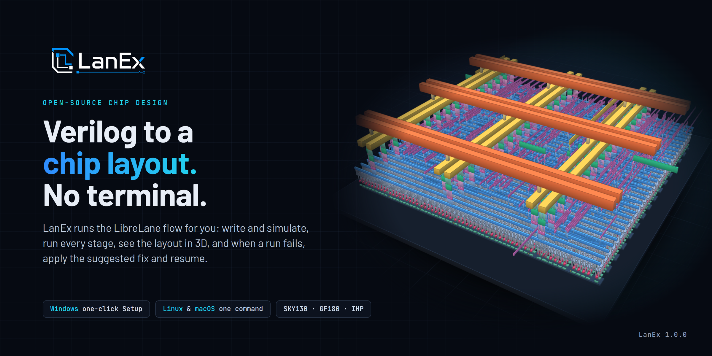</p>

# LanEx 1.0.0 beta 1

LanEx takes a Verilog design all the way to a chip layout (a GDS file) with the open-source [LibreLane](https://github.com/librelane/librelane) flow, from a window instead of a terminal. You write and simulate your design, press Run, watch every stage, look at the finished chip in 2D and 3D, and when a run fails, LanEx tells you why in plain words and offers the fix.

This is the first public beta. It installs with one click on Windows and with one command on Linux and macOS.

## Install

### Windows 10 / 11

1. Download **LanEx-Setup.exe** below (6.1 MB, SHA-256 `3c5608f947d2955834d95462821fa8d4b425bcbfea58738ff526a9464c0f7711`).
2. Run it. Windows says "Windows protected your PC" because the installer is not code-signed yet: click **More info**, then **Run anyway**.
3. Click through Welcome, License and Configure (**Recommended** is right for a first chip), then **Install**. If WSL is not on yet, Windows asks for administrator permission and restarts once; Setup opens again by itself after you sign in.
4. On the last page click **Finish**. LanEx opens. Pick **Make my first chip** and follow the six short steps.

Everything goes into a private Linux environment of its own: your other WSL distros are not touched. Uninstall keeps your projects, tools and PDKs unless you ask it not to.

### Linux and macOS

```bash
curl -fsSL https://raw.githubusercontent.com/AkshatIsWired/lanex/main/scripts/install.sh | bash
```

Works on Debian/Ubuntu, Fedora, Arch, openSUSE, macOS 13+ and inside WSL2. In a terminal it opens an installer with the same choices as Windows Setup, shows the download and disk size first, asks for your password once, and installs with a progress view. Then run `lanex`.

<p align="center">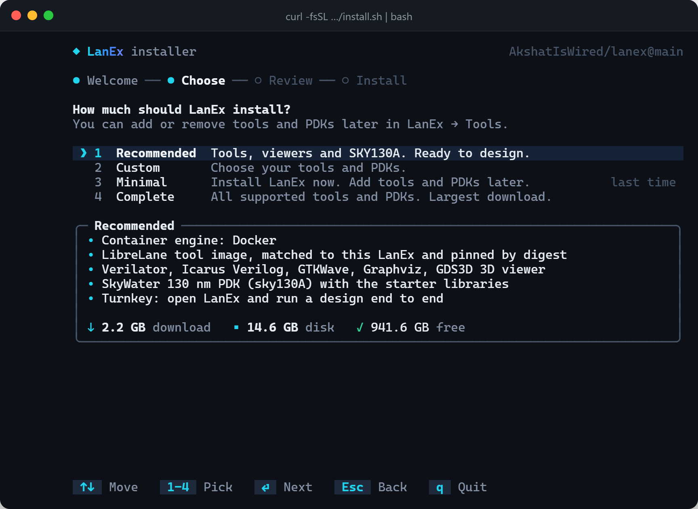</p>

Unattended: `... | bash -s -- --profile recommended`. More in [docs/INSTALL.md](https://github.com/AkshatIsWired/lanex/blob/main/docs/INSTALL.md).

## What it does

<p align="center">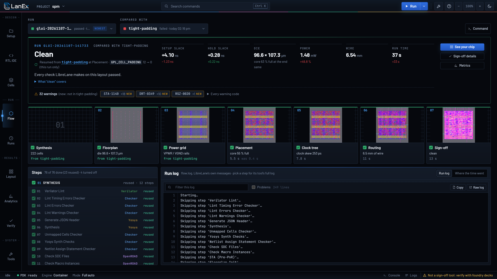</p>

**Run the flow and watch it.** Seven stages light up as LibreLane finishes them, each with a picture of the chip at that point and its key number. The run log streams live, and any step's own log is one click away.

<p align="center">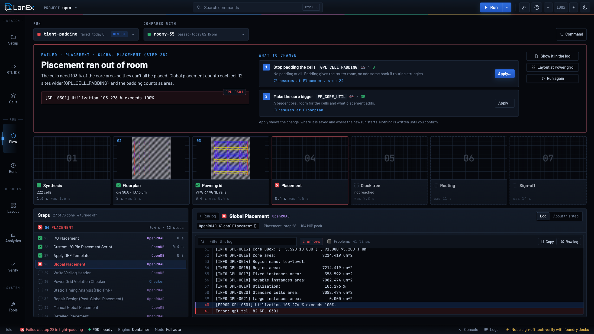</p>

**A failed run tells you what to change.** LanEx reads the error, says what went wrong in plain words, and lists the settings that fix it. **Apply** resumes the run from the stage that failed, reusing the earlier stages. In the picture above: placement ran out of room, one setting changed, and the resumed run was clean 37 seconds later.

<p align="center">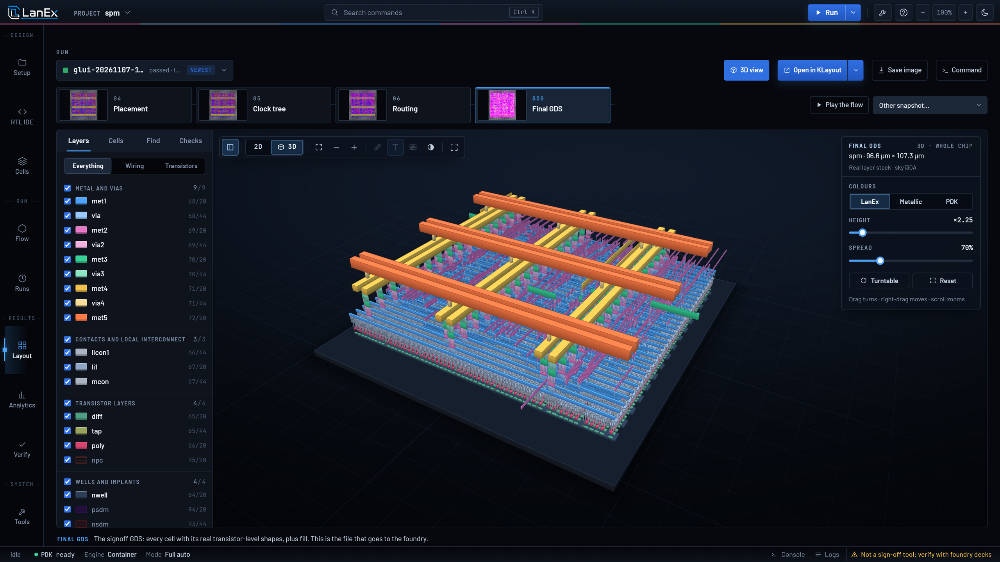</p>

**See your chip.** The Layout tab shows every stage of the layout, every layer and every cell, and the finished chip in 3D with its real layer stack. KLayout, Magic and GDS3D open from the same page.

<table>
<tr>
<td width="50%">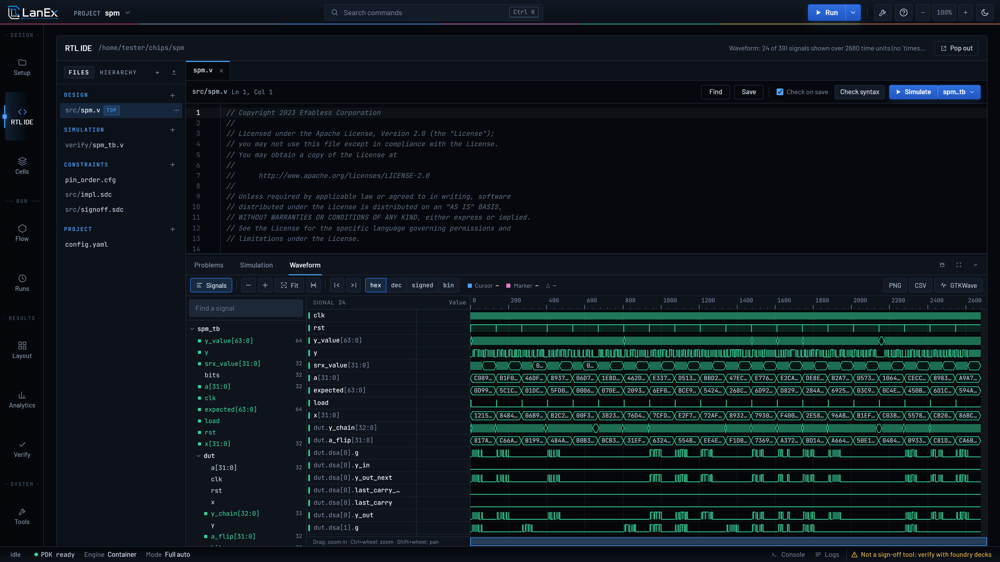<br><b>RTL IDE.</b> Edit, lint and simulate Verilog; the waveform opens in the app.</td>
<td width="50%">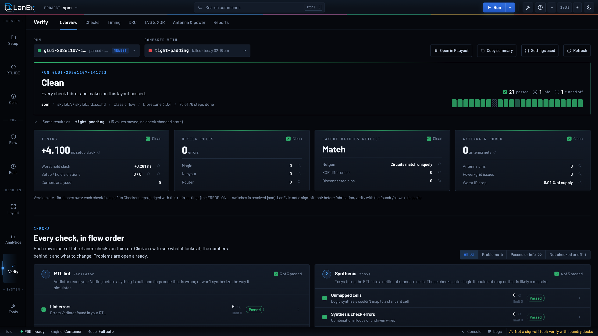<br><b>Verify.</b> Every check LibreLane makes on the layout, in flow order, each with its limit and report.</td>
</tr>
<tr>
<td>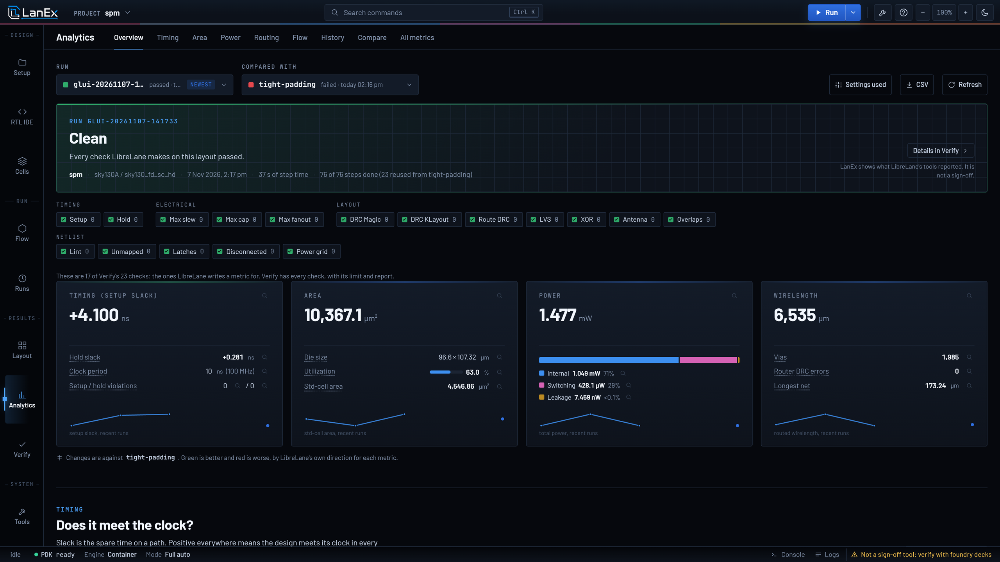<br><b>Analytics.</b> Timing, area, power and routing for a run, against any other run.</td>
<td>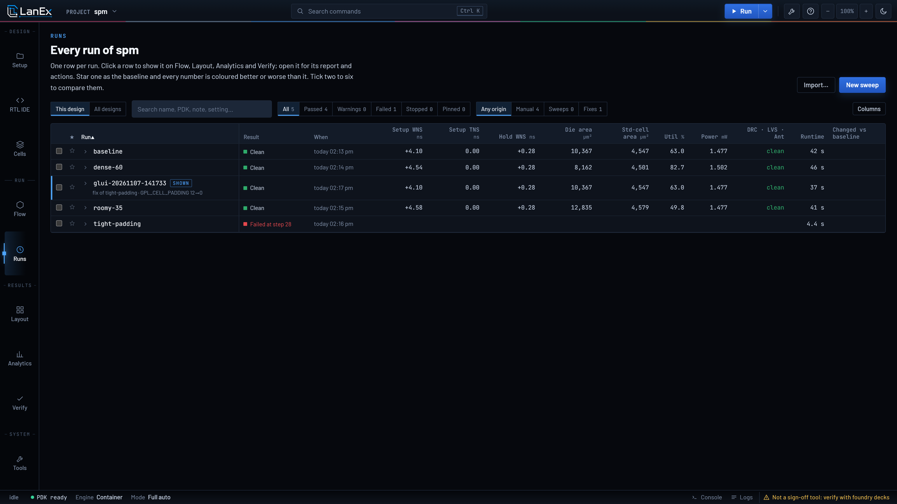<br><b>Runs.</b> Every run in one table: compare, pick a baseline, sweep a setting.</td>
</tr>
<tr>
<td>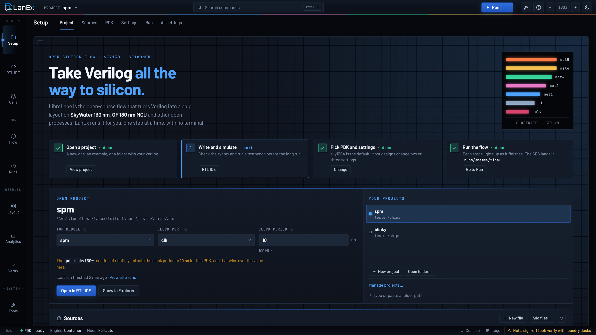<br><b>Setup.</b> New project from an example or your own Verilog, PDK and settings, and a readiness check before you run.</td>
<td>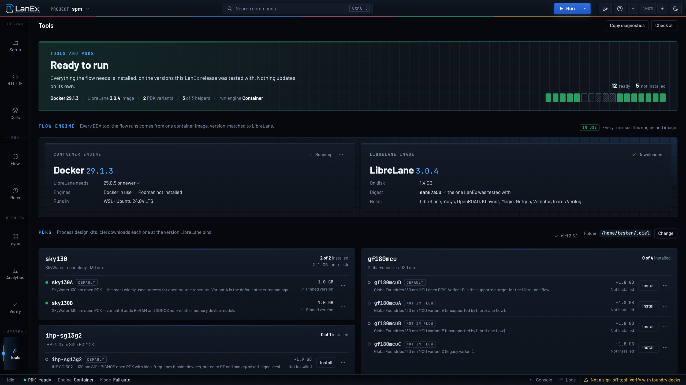<br><b>Tools.</b> The container engine, the LibreLane image and the PDKs, each pinned to the version LanEx was tested with.</td>
</tr>
</table>

Processes: SkyWater 130 nm (sky130A, sky130B), GlobalFoundries 180 nm (gf180mcuD) and IHP 130 nm (ihp-sg13g2).

## Measured

On a clean Windows 11 virtual machine (2 cores, 8 GB) with this build, Recommended profile:

| | |
|---|---|
| Install to "Ready to design", including the restart | 14 min 39 s |
| Blinky, from the first-chip guide to a clean GDS | 1 min 2 s of flow |
| Disk used afterwards | 13.3 GB (have about 23 GB free) |
| Downloaded | about 2.4 GB |

Requirements on Windows: Windows 11, or Windows 10 22H2 with its updates (19045.2311 or newer); x64; 6 GB of memory at least, 8 GB recommended; about 23 GB free on C:.

## Pinned and checked

Every download is pinned and hash-checked: the LibreLane tool image by digest, each PDK file by SHA-256, the Python packages by version (Windows: by hash too), the Ubuntu base image by SHA-256. A partial or corrupt download is retried, never used. Setup survives a restart, a dropped connection, a closed window or a PC that slept, and every error names its log file.

## Known limits

- LanEx is not a sign-off tool. "Clean" means LibreLane's own checks passed (DRC in Magic and KLayout, LVS, XOR, antenna, timing in its corners). It does not replace gate-level simulation with delays, a shuttle's precheck or a foundry's sign-off decks.
- Windows: this build was run on a Windows 11 Enterprise virtual machine; the same installer passed on Windows 10 Enterprise with the previous build. Home and Pro were not run. Windows 10 asks for administrator permission twice, and its first WSL start after the restart can take about five minutes.
- macOS: the installer and the Docker Desktop path are covered by tests, but this build has not been run on a real Mac yet. Reports welcome.
- Not code-signed yet.

## If it goes wrong

Open an issue. On Windows use the **Windows install problem** form and attach `%LOCALAPPDATA%\LanEx\logs\install.log` (paste that path into Explorer's address bar). On Linux and macOS attach the log the installer names at the bottom of its screen (`~/.lanex/logs/install-*.log`).
